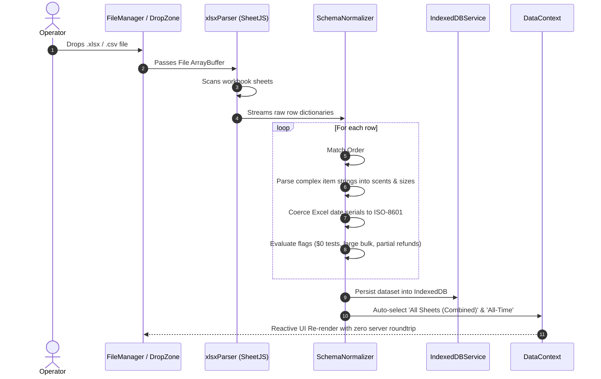
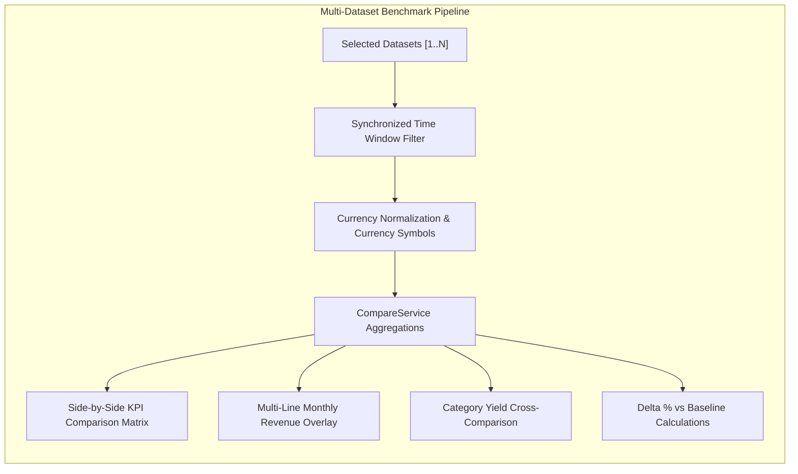

# Ledgerify — Technical Architecture & System Design

<div align="center">
  
  <h3>Enterprise Client-Side E-Commerce Intelligence Engine</h3>
  <p>Zero-Backend · Browser-Native SheetJS Parsing · Inversion of Control · Obsidian Design System</p>
</div>

---

## 1. Architectural Philosophy & Principles

Ledgerify is designed from the ground up as a **100% client-side, zero-backend, multi-departmental intelligence platform** for e-commerce ledgers and Shopify workbooks. It adheres to strict software engineering standards:

```
┌─────────────────────────────────────────────────────────────────────────┐
│                          Core Architectural Pillars                     │
├──────────────────────┬──────────────────────────┬───────────────────────┤
│ Separation of        │ Inversion of Control     │ Zero-Knowledge        │
│ Concerns (SoC)       │ & Dependency Injection   │ Client Privacy        │
│                      │                          │                       │
│ Strict decoupling    │ Business algorithms live │ 100% in-browser       │
│ between parsing,     │ in pure TypeScript       │ processing. In-memory │
│ domain calculations, │ services injected via    │ parsing, IndexedDB    │
│ state management,    │ ServiceContainer &       │ persistence, zero     │
│ and UI controllers.  │ React ServiceContext.    │ network transmissions.│
└──────────────────────┴──────────────────────────┴───────────────────────┘
```

---

## 2. High-Level System Architecture

The system is organized into four distinct architectural tiers:

```mermaid
flowchart TB
    subgraph IngestionTier["1. Ingestion & Normalization Engine"]
        F1["Raw File (.xlsx / .csv)"] --> P1["XlsxParser / SheetJS Worker"]
        P1 --> N1["Schema Normalization Pipeline"]
        N1 --> D1["Fuzzy Header Matcher"]
        N1 --> D2["Category & Scent Splitter"]
        N1 --> D3["Date Serial Coercion"]
        N1 --> D4["Quality & Anomaly Flagging"]
    end

    subgraph StorageTier["2. Persistence & Cache Layer"]
        N1 --> S1["IStorageService"]
        S1 --> S2["Browser IndexedDB (ledgerify_store)"]
        S1 --> S3["LocalStorage Config Cache"]
    end

    subgraph DomainTier["3. Domain Services (IoC Container)"]
        S1 --> IOC["ServiceContainer (IoC)"]
        IOC --> SRV1["ExecutiveService"]
        IOC --> SRV2["FinanceService"]
        IOC --> SRV3["InventoryService"]
        IOC --> SRV4["OperationsService"]
        IOC --> SRV5["MarketingService"]
        IOC --> SRV6["CreativeService"]
        IOC --> SRV7["CompareService"]
        IOC --> SRV8["AdminQualityService"]
    end

    subgraph PresentationTier["4. Presentation Layer (Obsidian UI)"]
        IOC --> CTX1["DataContext"]
        IOC --> CTX2["FilterContext"]
        IOC --> CTX3["ServiceContext"]
        CTX1 & CTX2 & CTX3 --> UI1["Executive View"]
        CTX1 & CTX2 & CTX3 --> UI2["Finance View"]
        CTX1 & CTX2 & CTX3 --> UI3["Inventory View"]
        CTX1 & CTX2 & CTX3 --> UI4["Operations View"]
        CTX1 & CTX2 & CTX3 --> UI5["Marketing View"]
        CTX1 & CTX2 & CTX3 --> UI6["Creative View"]
        CTX1 & CTX2 & CTX3 --> UI7["N-Way Compare Engine"]
        CTX1 & CTX2 & CTX3 --> UI8["Data Health Admin"]
    end
```



---

## 3. Data Ingestion & Resilient Normalization Pipeline

Shopify exports vary drastically across stores, regions, and export apps (e.g. composite line items, missing emails, varied date formats). The normalization engine ensures 100% deterministic schema mapping:



### Dynamic Scent & Bottle Size Extraction
Compound line items (e.g., `"Silk Odyssey 50ml, Visionary Discovery Set"`) are parsed using dynamic tokenization regex:
- Identifies base fragrance names (e.g. `Silk Odyssey`, `Visionary`, `Oud Celestial`).
- Discovers product formats and packaging sizes (e.g. `50ml`, `100ml`, `Discovery Set`, `Trio`, `Extrait`).
- Assigns quantities and line-item revenue allocations to categories automatically.

---

## 4. Class Diagram & Inversion of Control (IoC)

Domain services are encapsulated classes that implement pure calculation logic without React coupling:

```mermaid
classDiagram
    class IFileParser {
        <<interface>>
        +parse(file: File): Promise~Dataset~
    }

    class IStorageService {
        <<interface>>
        +saveDataset(dataset: Dataset): Promise~void~
        +getDatasets(): Promise~Dataset[]~
        +deleteDataset(id: string): Promise~void~
        +clearAll(): Promise~void~
    }

    class ServiceContainer {
        +executiveService: ExecutiveService
        +financeService: FinanceService
        +inventoryService: InventoryService
        +operationsService: OperationsService
        +marketingService: MarketingService
        +creativeService: CreativeService
        +compareService: CompareService
        +adminService: AdminDataQualityService
    }

    class ExecutiveService {
        +calculateMetrics(orders: NormalizedOrder[]): ExecutiveMetrics
    }

    class FinanceService {
        +calculateMetrics(orders: NormalizedOrder[]): FinanceMetrics
    }

    class InventoryService {
        +calculateMetrics(orders: NormalizedOrder[]): InventoryMetrics
    }

    class OperationsService {
        +calculateMetrics(orders: NormalizedOrder[]): OperationsMetrics
    }

    class MarketingService {
        +calculateMetrics(orders: NormalizedOrder[]): MarketingMetrics
    }

    class CompareService {
        +compareDatasets(dsA, dsB, ordersA, ordersB): CompareMetrics
        +compareMultipleDatasets(datasets, selectedIds, period): MultiDatasetMetrics
    }

    ServiceContainer --> ExecutiveService
    ServiceContainer --> FinanceService
    ServiceContainer --> InventoryService
    ServiceContainer --> OperationsService
    ServiceContainer --> MarketingService
    ServiceContainer --> CompareService
```



---

## 5. State Management & Reactive Data Hierarchy

State flows through three dedicated React contexts that isolate concerns:

1. **`ServiceContext`**: Instantiates and provides the singleton `ServiceContainer` instance via dependency injection.
2. **`DataContext`**:
   - Manages active datasets, multi-dataset collections, active workbook sheets, compare mode toggles, and modal drilldown state.
   - Enforces default configurations (`All Sheets (Combined)`, `All-Time Period`).
   - Syncs state changes with IndexedDB for browser-level persistence across reloads.
3. **`FilterContext`**:
   - Manages period filtering (`All-Time`, `Month`, `Custom Date Range`), channel filters, and multi-dataset time overlays.
   - Computes `filteredOrders` reactively without mutating raw dataset buffers.

---

## 6. N-Way Dataset Comparison Architecture

Ledgerify supports dynamic multi-file benchmarking across $N$ arbitrary datasets (e.g. UK Store 2024 vs UK Store 2025 vs US Store vs UAE Store):



---

## 7. Geographic Logistics Vector Projection Engine

The geographic visualization engine ([GeoDistributionMap.tsx](file:///home/leech/Projects/Ledgerify/src/components/charts/GeoDistributionMap.tsx)) provides zero-dependency, self-contained SVG map vector rendering:

- **Region-Adaptive Projections**:
  - **UK & Ireland View** (`viewBox="0 0 800 650"`): Spaced regional vectors for Scotland, Northern Ireland, North England, Midlands, Wales, and Greater London.
  - **North America View** (`viewBox="0 0 900 550"`): Pacific, Mountain, Midwest, Texas, and East Coast commerce hubs.
  - **UAE / GCC View** (`viewBox="0 0 800 500"`): Arabian Gulf and Emirates logistics hubs.
- **Interactive Pan & Zoom HUD Engine**:
  - Center-anchored matrix scaling from `60%` to `400%`.
  - Mouse drag panning with gesture tracking (`isDragging`, `dragThreshold`).
  - Wheel zooming & mobile touch gestures.
  - Real-time HUD zoom percentage display and one-click view reset.

---

## 8. Domain-Specific Intelligence Dossier System

Clicking infographics, customers, Best-Sellers, or heatmap cells invokes the **Domain Intelligence Dossier Modal** ([DrillDownModal.tsx](file:///home/leech/Projects/Ledgerify/src/components/ui/DrillDownModal.tsx)):

- **Customer / VIP (`type: 'customer'`)**: Luxury Customer 360 CRM profile with lifetime spend, repeat frequency, preferred scent tags, and chronological purchase timeline.
- **Fragrance Velocity (`type: 'fragrance'`)**: Dynamic packaging format breakdown (50ml vs 100ml vs Sample), restock status, and top buyers list.
- **Category Yield (`type: 'category'`)**: Top moving scents in that format, format price spread, and yield metrics.
- **Warehouse Fulfillment (`type: 'day'`)**: Operational packing station recommendations, single-item envelope vs multi-item box split, and packing alerts.
- **Financial Cash Flow (`type: 'revenue'`)**: Gross inflow vs refund liability progress bar, net ledger yield, and high-value transaction spotlight.
- **Logistics Hubs (`type: 'orders'`)**: Regional parcel volume tags, destination city stats, and localized order manifests.

---

## 9. Security, Privacy & Performance Constraints

- **Zero Network Exfiltration**: All data stays inside the user's browser runtime. No analytics, tracking pixels, or external API relays are used.
- **Memory Optimization**: In-memory parsing leverages lightweight typed representations (`NormalizedOrder[]`), freeing raw binary arrays immediately after normalization.
- **Instantaneous Context Switching**: Departmental view transitions execute with $0\text{ms}$ network latency.
