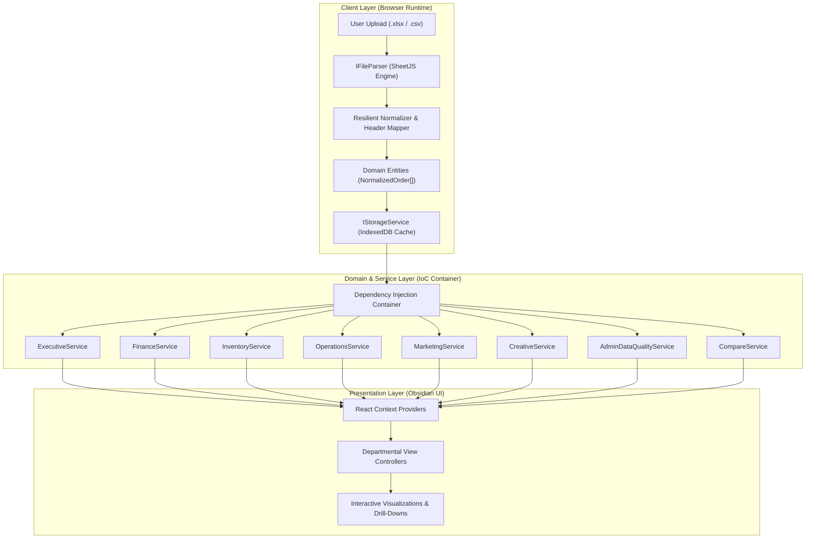
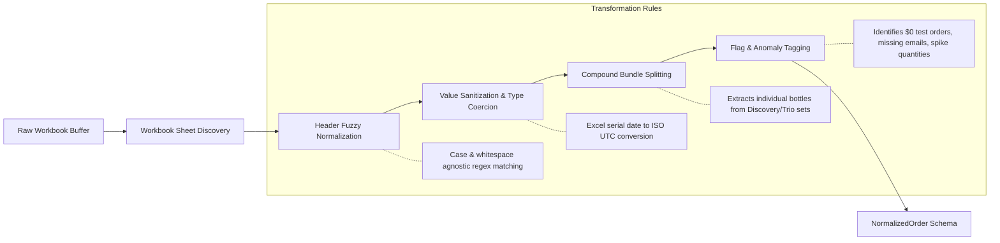
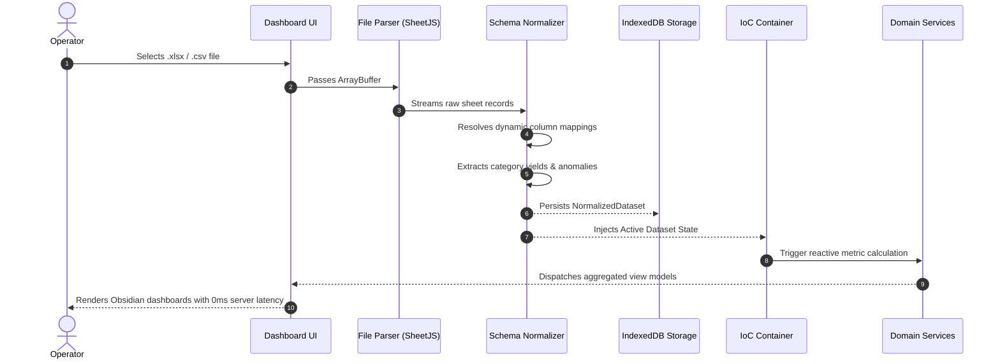
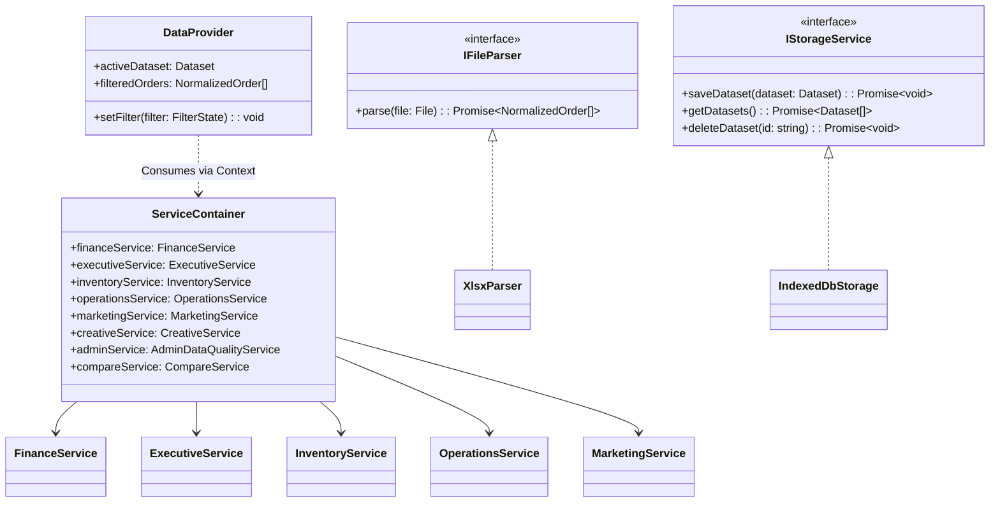
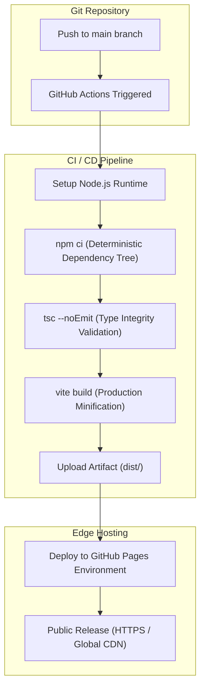

<div align="center">

# Ledgerify

### Client-Side Shopify Ledger Intelligence & Multi-Department Analytics

A resilient, browser-native analytics platform engineered for complex Shopify Excel exports. Built with an Obsidian dark interface, zero-backend architecture, dynamic schema normalization, and multi-departmental intelligence.

[](https://www.typescriptlang.org/)
[](https://react.js.org/)
[](https://vitejs.dev/)
[](https://tailwindcss.com/)
[](LICENSE)
[](https://github.com/AhmadHassan-BTed/.github/actions)

[Live Demonstration](https://ahmadhassan-bted.github.io/.github/) • [Documentation](#architecture-overview) • [Contributing](#contributing-and-standards)

</div>

---

## Overview

Modern e-commerce ledgers generated by Shopify exports often contain irregular schemas, composite product bundles, inconsistent date serials, and fragmented departmental requirements. Ledgerify was created to solve this problem entirely on the client side.

By combining browser-native SheetJS parsing, resilient schema normalization, and an Inversion-of-Control (IoC) dependency injection container, Ledgerify transforms raw, multi-megabyte Excel spreadsheets into structured domain intelligence across eight specialized organizational roles without sending data to an external server.

The platform provides human-centric visibility: leaders and operators receive clear, synthesized conclusions rather than being overwhelmed by raw tabular data.

---

## Architectural Principles

Ledgerify is built upon three core engineering pillars:

1. **Separation of Concerns (SoC)**: Strict isolation between parsing, storage, domain metric calculation, and UI presentation.
2. **Dependency Injection (DI)**: Business logic resides in decoupled domain services injected through a lightweight IoC container.
3. **Zero-Knowledge Privacy**: 100% client-side computation. Workbooks are parsed in-memory, cached in browser IndexedDB, and never transmitted over the network.

---

## Architecture Overview



---

## Data Flow & Normalization Pipeline

Raw Shopify exports exhibit variations across stores, countries, and export configurations. The normalization pipeline dynamically detects headers, reconciles currency formats, and structures composite line items.



---

## Request & Parsing Lifecycle

When an operator uploads a workbook or toggles between datasets, the execution flow follows a deterministic, non-blocking lifecycle:



---

## Module Relationship & Dependency Injection

The application decouples interface components from domain calculation algorithms through the Service Context and IoC Container.



---

## Build & Deployment Pipeline

Ledgerify utilizes automated continuous integration via GitHub Actions, compiling TypeScript bundles and deploying static assets to GitHub Pages.



---

## Departmental Perspectives

Ledgerify structures analytical output into eight dedicated dashboards, each aligned with specific business functions:

| View Perspective | Target Role | Key Metrics & Visualizations | Status |
| :--- | :--- | :--- | :---: |
| **Executive** | CEO / Founders | Month-over-Month trajectory, buyer retention rates, revenue pacing gauge, customer acquisition split. | ✓ |
| **Finance** | CFO / Controller | Gross ledger totals, net revenue, category yields (50ml, 100ml, Discovery, Trio), refund liabilities. | ✓ |
| **Inventory** | Supply Chain / Ops | Fragrance velocity meters, reorder urgency triage, composite set extraction, physical bottle share. | ✓ |
| **Operations** | Warehouse / Fulfillment | Day-of-week dispatch heatmap, shipping province hotspots, multi-box packing complexity ratios. | ✓ |
| **Marketing** | Growth / Performance | High-value customer tiers, geographic ad allocation, cart co-purchase affinity matrix, repeat cohorts. | ✓ |
| **Creative** | Design & Studio | Visual brief generators, hero product identification, packaging style trends, scent keyword demand. | ✓ |
| **Admin Quality** | Data Engineers | Automated health scores, missing field audits, test order isolation, quantity spike detection. | ✓ |
| **Comparison** | Strategy & Finance | Side-by-side multi-file benchmarking, variance delta calculations, dual-series curves. | ✓ |

---

## Technical Specifications

<details>
<summary><strong>Schema & Field Normalization Specifications</strong></summary>

### Supported Input Columns (Fuzzy Matched)
The normalizer handles varied naming conventions across Shopify CSV and Excel exports:

- **Order Identifier**: `Name`, `Order ID`, `Order Number`, `#`, `Invoice ID`
- **Timestamp**: `Created at`, `Order Date`, `Date`, `Processed at`, `Sale Date`
- **Customer Email**: `Email`, `Customer Email`, `Contact Email`
- **Financial Status**: `Financial Status`, `Payment Status`, `Status`
- **Total Amount**: `Total`, `Total Amount`, `Gross Sales`, `Net Sales`, `Subtotal`
- **Item Summary**: `Lineitem name`, `Item Name`, `Items`, `Products`, `Description`
- **Quantity**: `Lineitem quantity`, `Total Quantity`, `Quantity`, `Qty`
- **Shipping Destination**: `Shipping City`, `City`, `Shipping Province`, `State`, `Region`

</details>

<details>
<summary><strong>Local Storage & Security Architecture</strong></summary>

### Client-Side Isolation
- **Storage Layer**: IndexedDB database (`LedgerifyDB`) operating within origin sandboxing.
- **Data Retention**: Workbooks persist locally in the operator's browser session or local storage cache.
- **Zero Third-Party Tracking**: No analytics scripts, remote beacons, or external telemetries are bundled.

</details>

---

## Repository Structure

```
Ledgerify/
├── .github/
│   └── workflows/
│       └── deploy.yml              # GitHub Actions Pages deployment pipeline
├── scripts/
│   ├── inspect.js                  # CLI utility for workbook inspection
│   └── inspect_sheets.js           # Multi-sheet diagnostic analyzer
├── src/
│   ├── components/
│   │   ├── charts/                 # Recharts components (Area, Bar, Donut, Multi-Series)
│   │   ├── layout/                 # Top navigation, dataset switcher, theme controls
│   │   ├── ui/                     # Atomic UI cards, heatmaps, gauges, tables
│   │   └── views/                  # 8 departmental dashboard implementations
│   ├── context/
│   │   ├── DataContext.tsx         # Dataset state and upload orchestrator
│   │   ├── FilterContext.tsx       # Date, search, and category filter provider
│   │   ├── ServiceContext.tsx      # Dependency injection context provider
│   │   └── ThemeContext.tsx        # Obsidian dark / light mode manager
│   ├── core/
│   │   ├── di/
│   │   │   └── container.ts        # IoC Service Container
│   │   ├── parser/
│   │   │   ├── IFileParser.ts      # Parser contract
│   │   │   ├── normalizer.ts       # Resilient header & entity normalizer
│   │   │   └── xlsxParser.ts       # SheetJS workbook parser
│   │   ├── services/               # Pure departmental calculation services
│   │   └── storage/                # IndexedDB persistence adapter
│   ├── styles/
│   │   └── themes/                 # CSS theme definitions and role accents
│   ├── types/                      # Domain interfaces and analytics models
│   ├── App.tsx                     # Root application container
│   ├── index.css                   # Obsidian design tokens and base styles
│   └── main.tsx                    # Application entry point
├── package.json                    # Project manifests and scripts
├── tsconfig.json                   # TypeScript compiler configuration
└── vite.config.ts                  # Vite build bundler configuration
```

---

## Development Workflow

### Prerequisites
- Node.js 20.0 or higher
- npm 9.0 or higher

### Local Setup
```bash
# Clone the repository
git clone https://github.com/AhmadHassan-BTed/.github.git Ledgerify
cd Ledgerify

# Install dependencies deterministically
npm ci

# Start the local development server
npm run dev
```

The application will be accessible at `http://localhost:5173`. A sample ledger is pre-bundled for instant local evaluation.

### Verification & Production Build
```bash
# Execute TypeScript type validation and Vite production bundling
npm run build

# Preview production build locally
npm run preview
```

---

## Contributing and Standards

Contributions adhering to strict engineering standards are welcomed. When submitting changes:

1. Maintain complete **Separation of Concerns**: calculation logic belongs in `core/services/`, not inside presentation components.
2. Ensure strict TypeScript type safety without the use of `any` overrides where domain models exist.
3. Validate that parsing resilience handles corrupted inputs, `$0` test orders, and missing columns without runtime exceptions.
4. Verify that `npm run build` passes with zero errors before opening pull requests.

---

## Author & Attribution

Engineered and designed by **Ahmad Hassan (B-Ted)**.

---

## License

This project is open-source software licensed under the [MIT License](LICENSE).
